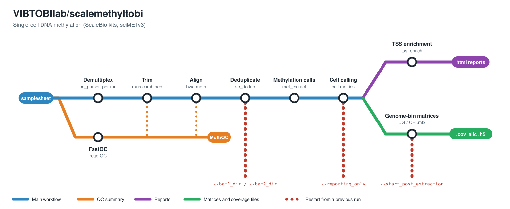

# VIBTOBIlab/scalemethyltobi

[](https://github.com/VIBTOBIlab/ScaleMethylTOBI/actions/workflows/nf-test.yml)
[](https://github.com/VIBTOBIlab/ScaleMethylTOBI/actions/workflows/linting.yml)
[](https://www.nf-test.com)

[](https://www.nextflow.io/)
[](https://github.com/nf-core/tools/releases/tag/4.2.2)
[](https://docs.conda.io/en/latest/)
[](https://www.docker.com/)
[](https://sylabs.io/docs/)

## Introduction

**VIBTOBIlab/scalemethyltobi** is a Nextflow pipeline for single-cell DNA methylation libraries made by combinatorial indexing (ScaleBio Single Cell Methylation kits and sciMETv3). It takes sequencing reads to alignments, per-cell methylation calls (Bismark `.cov`, ALLC, Amethyst `.h5`), genome-bin matrices and QC reports.

This repository is based on the ScaleBio Seq Suite: Methylation workflow (v1.3.1), originally available at https://github.com/ScaleBio/ScaleMethyl. It adds library structures and helper scripts for **sciMETv3** libraries (Nichols et al. 2025, _Cell Genomics_ 5:100726), a fix for alignment against shared bwa-meth indexes, restructured documentation, and the structure, tests and CI of the [nf-core](https://nf-co.re) pipeline template.



1. Read QC ([`FastQC`](https://www.bioinformatics.babraham.ac.uk/projects/fastqc/))
2. Barcode demultiplexing by sample and Tn5 well with error correction (`bc_parser`), per library and sequencing run
3. Adapter trimming ([`cutadapt`](https://cutadapt.readthedocs.io)), combining the sequencing runs of each sample
4. Alignment ([`bwa-meth`](https://github.com/brentp/bwa-meth) with bwa-mem2), with a pre-built genome (`hg38`, `mm39`) or your own
5. Deduplication per cell barcode (`sc_dedup`)
6. Methylation extraction: per-cell CG and CH methylation calls
7. Cell calling, TSS enrichment and HTML QC reports per sample and per library
8. Per-cell coverage files (Bismark `.cov`, ALLC, Amethyst `.h5`) and genome-bin methylation matrices
9. Read QC, trimming and alignment summary ([`MultiQC`](https://multiqc.info))

## Supported libraries

| Library                                          | `--lib_structure`        |
| ------------------------------------------------ | ------------------------ |
| ScaleBio Single Cell Methylation kit v1.0 / v1.1 | `lib.json` (default)     |
| ScaleBio alpha kit                               | `prev_pcr/lib.json`      |
| sciMETv3 with the paper's i5 primers             | `sciMETv3/lib.json`      |
| sciMETv3 with TruSeq HT D501-D508 i5 primers     | `sciMETv3/lib_D50x.json` |

## Usage

> [!NOTE]
> If you are new to Nextflow and nf-core, please refer to [this page](https://nf-co.re/docs/get_started/environment_setup/overview) on how to set-up Nextflow. Make sure to test your setup with `-profile test` before running the workflow on actual data:
>
> ```bash
> nextflow run VIBTOBIlab/scalemethyltobi -profile test,docker --outdir test_results
> ```

First, prepare a samplesheet with the samples of your libraries and the fastq files of the libraries:

`samples.csv`:

```csv
sample,barcodes,libName,fastq_1,fastq_2,index_1,index_2
PBMC-S1,1A01-2D12,ScaleMethyl,fastq/Lib_R1_001.fastq.gz,fastq/Lib_R2_001.fastq.gz,fastq/Lib_I1_001.fastq.gz,fastq/Lib_I2_001.fastq.gz
PBMC-S2,2E01-3H12,ScaleMethyl,fastq/Lib_R1_001.fastq.gz,fastq/Lib_R2_001.fastq.gz,fastq/Lib_I1_001.fastq.gz,fastq/Lib_I2_001.fastq.gz
```

Each row is a sample: its name, its Tn5 barcode wells, its library and the fastq files (R1, R2, I1, I2) of the library. Add rows for more sequencing runs of a library; they are combined per sample. See the [samplesheet](docs/user-guide/samples-csv.md) documentation.

Now, you can run the pipeline using:

```bash
nextflow run VIBTOBIlab/scalemethyltobi \
   -profile <docker/singularity/.../institute> \
   --input samples.csv \
   --genome hg38 \
   --outdir <OUTDIR>
```

`--genome` selects a pre-built genome (`hg38` or `mm39`) that the pipeline downloads and unpacks; for other genomes give your own `genome.json` with `--genome_json`. See [reference genomes](docs/user-guide/reference-genomes.md). The fastq files are generated before the run, with the index reads (see [input data](docs/user-guide/input-data.md)).

> [!WARNING]
> Please provide pipeline parameters via the CLI or Nextflow `-params-file` option. Custom config files including those provided by the `-c` Nextflow option can be used to provide any configuration _**except for parameters**_; see [docs](https://nf-co.re/docs/running/run-pipelines#using-parameter-files).

> [!IMPORTANT]
> Since version 1.5.0 the parameters use snake_case, as in nf-core pipelines (e.g. `--samples` is now `--input`, `--outDir` is `--outdir`). The fastq files are listed in the samplesheet (`--fastqDir` and `--runFolder` were removed), and bwa-meth is the only aligner. See the [changelog](CHANGELOG.md).

## Documentation

The full documentation is in [docs/](docs/index.md):

- [Installation](docs/getting-started/installation.md) and [test run](docs/getting-started/test-run.md)
- [Running the workflow](docs/user-guide/running.md), [input data](docs/user-guide/input-data.md), [sample table](docs/user-guide/samples-csv.md), [reference genomes](docs/user-guide/reference-genomes.md), [parameters](docs/user-guide/parameters.md), [restarting and merging](docs/user-guide/restarting-and-merging.md)
- [Output files](docs/outputs/output-files.md), [QC reports](docs/outputs/qc-reports.md), [barcode metrics](docs/outputs/barcode-metrics.md)
- [sciMETv3](docs/scimetv3/index.md)
- [Troubleshooting](docs/reference/troubleshooting.md) and [changelog](CHANGELOG.md)
- nf-core style summaries: [usage](docs/usage.md), [output](docs/output.md)

The documentation can be built as a website with [MkDocs](https://www.mkdocs.org):

```bash
pip install -r requirements-docs.txt
mkdocs serve          # preview at http://127.0.0.1:8000
```

On GitHub, `.github/workflows/docs.yml` builds the site for pull requests that change the docs and publishes it to GitHub Pages on every push to `main` (set _Settings > Pages > Source_ to **GitHub Actions**).

## Credits

VIBTOBIlab/scalemethyltobi is based on the ScaleMethyl workflow written by ScaleBio and is maintained by VIBTOBIlab.

We thank the following people for their contributions to this pipeline:

- [Edoardo Giuili](https://github.com/edogiuili)

## Contributions and Support

If you would like to contribute to this pipeline, please see the [contributing guidelines](docs/CONTRIBUTING.md). The development tools are pinned in `dev-environment.yml`.

## Citations

An extensive list of references for the tools used by the pipeline can be found in the [`CITATIONS.md`](CITATIONS.md) file.

This pipeline uses code and infrastructure developed and maintained by the [nf-core](https://nf-co.re) community, reused here under the [MIT license](https://github.com/nf-core/tools/blob/main/LICENSE).

> **The nf-core framework for community-curated bioinformatics pipelines.**
>
> Philip Ewels, Alexander Peltzer, Sven Fillinger, Harshil Patel, Johannes Alneberg, Andreas Wilm, Maxime Ulysse Garcia, Paolo Di Tommaso & Sven Nahnsen.
>
> _Nat Biotechnol._ 2020 Feb 13. doi: [10.1038/s41587-020-0439-x](https://dx.doi.org/10.1038/s41587-020-0439-x).

## License

By purchasing product(s) and downloading the software product(s) of ScaleBio, You accept all of the terms of the [License Agreement](LICENSE.md). If You do not agree to these terms and conditions, You may not use or download any of the software product(s) of ScaleBio.
